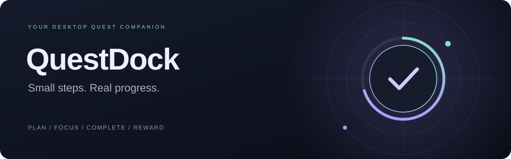

<div align="center">

**简体中文** · [English](README.en.md)



# QuestDock

**把今天要做的事，变成桌面上的任务与奖励。**

轻点悬浮球，安排今日任务、积累经验、兑换自己的奖励。

[](https://github.com/anayse/QuestDock/releases/latest)


[](LICENSE)
[](https://github.com/anayse/QuestDock/actions/workflows/release.yml)

[**下载 EXE 安装器**](https://github.com/anayse/QuestDock/releases/latest/download/QuestDock-Setup.exe) · [全部版本](https://github.com/anayse/QuestDock/releases) · [使用指南](docs/USER_GUIDE.md) · [开发指南](docs/DEVELOPMENT.md)

</div>

---

## 让进度留在视线里

任务不必一直占据整个屏幕。QuestDock 平时收在桌面边缘，需要时展开，完成一小步，就看到进度、代币与经验的变化。

把每天要做的事设为**每日任务**，把阶段目标放进**剧情任务**，把长期项目拆成**科研**或自己定义的类型。今天只挑值得投入的几项，不必把整个待办清单搬到眼前。

| 能力 | 实际体验 |
| --- | --- |
| **桌面悬浮球** | 点击展开任务栏；拖动贴边、自动收起、锁定位置，支持 1–100% 不透明度。 |
| **今日计划** | 手动挑选今日任务，也可按任务类型自动加入；悬浮球与进度条同步显示完成情况。 |
| **进度与成长** | 多目标任务按步结算代币与 XP；每累计 200 XP 升一级。 |
| **奖励商店** | 自定义奖励和价格，用代币兑换，放入背包后使用。 |
| **完成日历** | 周、月与自定义日期范围，查看每日任务的完成记录。 |
| **专注计时** | 25 分钟专注，可暂停、继续与结束；计时结果记入记录。 |

**你的任务由你定义。** 公开版首次启动没有预置任务，保留默认类型和通用商店商品。已有用户升级时继续使用本机存档。

## 安装与开始

### 1. 下载

从 [GitHub Releases](https://github.com/anayse/QuestDock/releases/latest) 选择适合的文件：

| 文件 | 用途 |
| --- | --- |
| **`QuestDock-Setup.exe`** | 推荐。下载后直接运行，打开中文安装界面。 |
| **`QuestDock-vX.Y.Z-Windows.zip`** | 完整解压后运行其中的同一个安装器。 |
| `QuestDock-update.bin` | 程序自动更新组件，无需手动下载或运行。 |
| `SHA256SUMS.txt` | 发布文件的 SHA-256 校验清单。 |

### 2. 选择位置

EXE 和 ZIP **都支持选择安装目录**。在安装界面输入路径或点击“浏览”，确认后点击“安装”；取消或关闭不会安装。

安装针对当前 Windows 用户，不需要 Python。请选择当前用户可写的位置。完成后可从桌面或开始菜单启动，也可在 Windows 的“已安装的应用”中找到 QuestDock。

### 3. 建立自己的任务循环

1. 点击悬浮球展开面板，发布第一个任务，填写类型、目标次数与奖励。
2. 加入“今日”，或在设置中让该任务类型自动加入今日。
3. 推进任务、积累代币，再到商店兑换自己的奖励。

> 多目标任务的奖励是**每次进度的奖励**。例如目标 3 次、奖励 30，完成全部进度可获得 90 代币与 90 XP。单目标任务完成后手动领取。减进度或撤销不会扣回已发奖励，重复推进不会重复发奖。

### 当前源码的交互改进（尚未发布到安装包）

以下改动属于 V1.2 之后的开发内容，现有 V1.2 安装包尚未包含这些改进。

| 操作 | 使用方式与规则 |
| --- | --- |
| **置顶任务** | 原“追踪”更名为“置顶”，卡片显示“已置顶”；再次点击取消。在当前筛选结果中，未完成的置顶任务优先显示，不会自动加入“今日”或启动专注计时。设置中的“任务面板置顶”则控制窗口是否显示在其他窗口上方。 |
| **修改任务奖励** | 点击任务卡的“编辑”（原“详情”）。奖励金额位于标题下方，可填写非负整数；已结算任务也保留编辑入口。点击“保存任务”生效，已领取的代币和经验不会重新计算，后续尚未奖励的进度使用新金额。 |
| **修改兑换价格** | 在商店点击商品的“编辑”，进入“编辑商品与价格”，修改名称和正整数代币价格后点击“保存修改”。新价格用于之后的兑换，已有背包奖励券保持不变。 |

例如，一个每次奖励 20 代币的任务已经完成并结算 1 次，将奖励改成 35 后，下一次新的进度获得 35 代币；之前的 20 代币与对应经验保持不变。

## 任务数据与更新

任务数据保存在本机：

```text
%APPDATA%\QuestDock\
├── save.json     当前存档
├── save.bak      上一次有效存档备份
└── updates\     自动更新缓存（下载更新后创建）
```

- **安装位置与数据位置分开。** 重装、升级和正常卸载保留任务存档；需要换安装目录时，先卸载再安装。
- **自动更新默认关闭。** 在“设置 → 版本与更新”中开启，或手动检查。新版在后台下载，校验通过后由你确认安装并重启。
- **版本独立保留。** 当前正式版为 V1.2；V1.0、V1.1 的发布记录仍可查看。V1.0/V1.1 升级到 V1.2 需手动运行一次新安装器。

备份、迁移、快捷键与常见问题见 [使用指南](docs/USER_GUIDE.md)。所有版本的变化见 [更新日志](CHANGELOG.md)。

## 源码导航

```text
QuestDock/
├── questdock/                 应用包：桌面、任务、控件与更新
│   ├── __main__.py            python -m questdock 的启动入口
│   ├── launcher.py            单实例锁与应用生命周期入口
│   ├── app.py                 存档、初始状态与基础任务逻辑
│   ├── premium.py             桌面应用组合与交互
│   ├── compact_ui.py          紧凑面板、列表与设置绘制
│   ├── desktop_*.py           窗口行为与贴边几何
│   ├── activity.py            完成记录、日期范围与日历
│   ├── task_types.py          类型管理与今日计划规则
│   ├── step_rewards.py        按步奖励与重复结算保护
│   ├── focus_timer.py         专注计时模型
│   ├── updater.py             版本检查、下载与完整性校验
│   ├── update_ui.py           更新界面与后台任务协调
│   └── resources/             运行时更新安装脚本
├── installer/                 EXE 安装界面与 Windows 安装/卸载脚本
├── tests/                     自动测试、隔离样例与路径验证
├── tools/                     打包、视觉预览与性能测量
├── assets/                    应用图标等构建资源
├── docs/                      使用、开发、架构文档与品牌图形
├── .github/workflows/         GitHub Actions 发布流程
├── requirements-build.txt     固定构建依赖
└── CHANGELOG.md               版本更新记录
```

本地的 `build/`、`dist/`、`releases/`、`test-output/` 和 `private-builds/` 是生成产物或私有备份，不属于公开源码。

## 本地开发

在 **Windows + Python 3.12** 环境中，从仓库根目录执行：

```powershell
python -m venv .venv
.\.venv\Scripts\python.exe -m pip install -r requirements-build.txt
.\.venv\Scripts\python.exe -m questdock
```

正常启动会读取当前用户的真实存档。开发界面时，建议使用隔离预览：

```powershell
.\.venv\Scripts\python.exe -m tools.preview_premium
```

预览使用通用样例与独立存档。预览选项、测试分组、打包和发布步骤见 [开发指南](docs/DEVELOPMENT.md)。

```powershell
# 全量测试：GUI 测试需要可用的 Windows 桌面会话
python -m unittest discover -s tests -t . -v

# 安装路径与脚本语法验证
.\tests\test_install_paths.ps1

# 生成新的版本目录，不覆盖已有版本
python -m tools.release
```

## 设计取舍

- **保持桌面安静：** 悬浮球不持续播放动画；滚动仅绘制可见列表，拖动事件合并处理。
- **让反馈明确：** 今日进度、等级、代币与任务记录各有含义，专注计时不自动判定任务完成。
- **让恢复可行：** 单实例锁避免多个进程竞争存档；保存、更新均保留备份，更新安装需确认。
- **保持规则可编辑：** 类型名称、今日计划规则、任务目标和商店奖励由用户决定。

内部模块关系与数据流见 [架构说明](docs/ARCHITECTURE.md)。

## 适用范围与反馈

当前实现面向 Windows 桌面，贴边行为以主显示器工作区为范围。商店奖励是个人约定，不会自动支付或购买商品；完成日历记录每日任务，不自动补录升级前的历史。

发现问题或有改进建议，请提交 [Issue](https://github.com/anayse/QuestDock/issues)，附上版本、Windows 缩放比例和复现步骤。分享截图或日志前请去掉个人任务内容。代码贡献可先阅读 [开发指南](docs/DEVELOPMENT.md)。

## 许可证

QuestDock 采用 **[Apache License 2.0](LICENSE)**，版权信息见 [NOTICE](NOTICE)。第三方依赖遵循各自的许可证。

Copyright 2026 anayse and QuestDock contributors.
