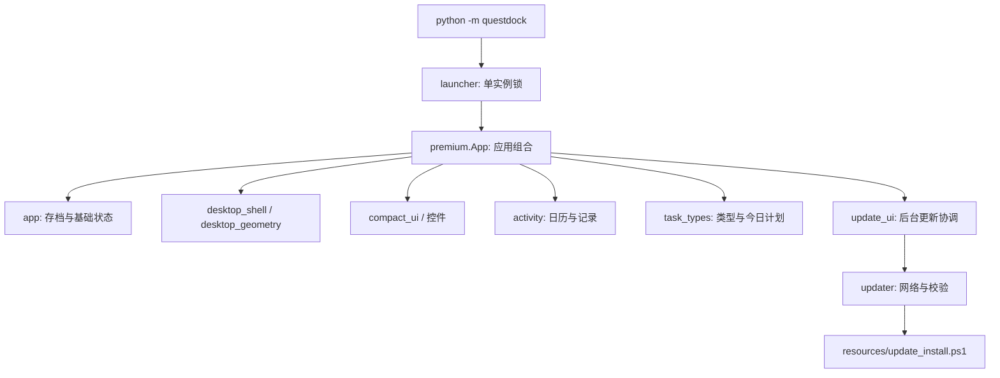
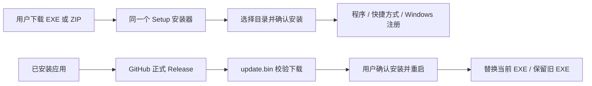

# 架构与模块地图

[返回首页](../README.md) · [开发指南](DEVELOPMENT.md)

QuestDock 是 Python / Tkinter 桌面应用。Windows 原生 API 用于悬浮球透明合成与工作区定位，Pillow 用于抗锯齿图像。当前采用组合式 UI 类；目录整理没有把现有模型与界面强行拆成独立服务。

## 启动与组合

`premium.App` 组合 `UpdateUI`、`TypeUI`、`ActivityUI`、`CompactUI`、`DesktopShell` 和基础 `app.App`。功能按主题定位，修改公共状态时仍需检查相关 mixin。

## 模块职责

| 文件 | 负责 | 修改时重点验证 |
| --- | --- | --- |
| `questdock/app.py` | 空白初始状态、JSON 存档、基础任务操作与跨日处理 | 旧存档、备份、空任务启动 |
| `questdock/premium.py` | 应用组合、任务交互、专注协调和表单 | 关闭生命周期、事件绑定、保存失败 |
| `questdock/compact_ui.py` | 紧凑主面板、虚拟列表、设置与命中区域 | 小尺寸布局、滚动、点击区域 |
| `questdock/desktop_shell.py` | 悬浮球拖动、收起、位置锁定与窗口控制 | 退出、锁定、贴边 |
| `questdock/desktop_geometry.py` | 工作区、吸附与位置计算 | 边界坐标、缩放 |
| `questdock/activity.py` | 每日快照、日期范围、日历界面 | 跨年、闰日、历史记录 |
| `questdock/task_types.py` | 类型迁移、改名、今日自动加入 | 自动与手动计划、每日重置身份 |
| `questdock/step_rewards.py` | 奖励结算高水位 | 撤销与重做不重复奖励 |
| `questdock/focus_timer.py` | 计时状态和经过时间 | 暂停、恢复、时钟中断 |
| `questdock/updater.py` | 版本选择、仓库来源、下载校验 | 缺失资产、损坏文件、版本排序 |
| `questdock/update_ui.py` | 后台线程、主线程结果队列、安装确认 | Tk 主线程限制、退出、保存失败 |
| `installer/setup_launcher.py` | 安装界面、路径输入、载荷解压和安装调用 | EXE/ZIP 一致、取消、失败提示 |

图形与控件集中在 `layered_orb.py`、`orb_art.py`、`ui_icons.py`、`styled_slider.py`、`slim_scrollbar.py`、`date_picker.py` 与 `notices.py`。

## 数据与刷新

用户状态保存在 `%APPDATA%\QuestDock\save.json`。正常保存前保留上一份有效 JSON，通过临时文件替换当前存档。相同内容不会重复写入。

跨日先保存每日任务快照，再重置每日进度和已结算步数，最后同步今日计划。非每日任务保留进度。类型的显示名称与每日重置身份分开，改名不改变原每日类型的刷新规则。

代币是可消费余额，累计获得的经验用于等级。多目标任务通过已结算步数避免撤销后重复领取；专注计时只记录投入时间。

## 安装与更新

安装脚本只操作选定的程序目录和应用注册，卸载脚本以登记的真实位置为准。两者均不删除用户存档。应用更新脚本是运行时资源；安装器脚本仅存在于安装载荷。

## 依赖边界

`questdock/` 不依赖 `tests/` 或 `tools/`。测试和预览可以依赖应用包，生产包不包含样例任务。`installer/` 只共享版本信息，不加载任务界面。`tools/` 编排构建与验证，不在应用正常启动时执行。
